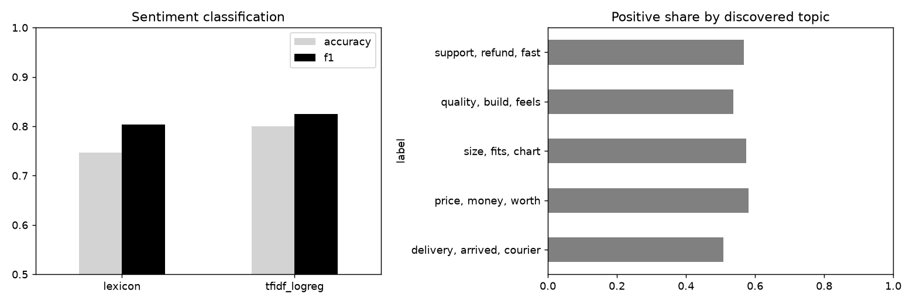

# review-text-mining

Customer review mining: sentiment classifier against a lexicon baseline, topic discovery with NMF.

## Task

Turn free-text reviews into two things a product team can use: sentiment and the topics people talk about.

## Approach

- Reviews are assembled from topic phrases (delivery, quality, price, support, size) with positive or negative wording, filler text and some mixed-sentiment reviews.
- Sentiment: TF-IDF with logistic regression against a small word-list baseline; the label comes from the star rating.
- Topics: NMF on TF-IDF with a custom stop-word list. `topic_purity` checks how consistently single-topic reviews land in one discovered topic.

## Results



- 4,000 reviews, 56% positive.
- Accuracy: logistic regression 0.800, lexicon baseline 0.747.
- Most negative terms: wrong, cheap, damaged, poor, high, lower. Most positive: penny, shops, great, accurate, excellent, solid.
- Topics found: delivery, arrived, courier | price, money, worth | size, fits, chart | quality, build, feels | support, refund, fast.
- Topic purity on single-topic reviews: 0.97.

The text is templated, so the numbers show that the pipeline works, not how it would do on real reviews. Real data would need cleaning for typos, negation and multiple languages.

## Run

```bash
pip install -r requirements.txt
python run.py      # generates data, runs the analysis, writes reports/
pytest             # unit tests
```

## Layout

```
src/data.py     data generation (fixed seed, no downloads)
src/core.py     analysis / model code
run.py          end-to-end script
tests/          unit tests
reports/        figures and summary.json produced by run.py
```

## Notes

The data is generated by `src/data.py` with a fixed random seed, so the numbers above are reproducible. It is synthetic: it is meant to show the method, and results on real data will differ.

Stack: pandas, scikit-learn, matplotlib.
